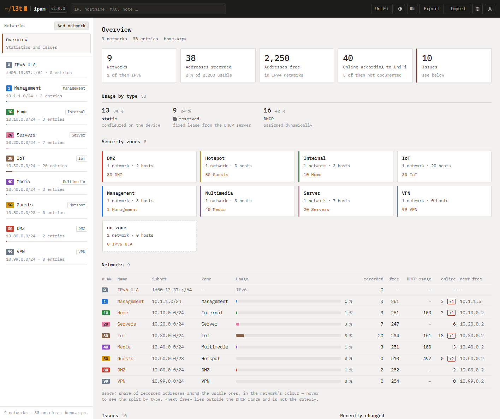
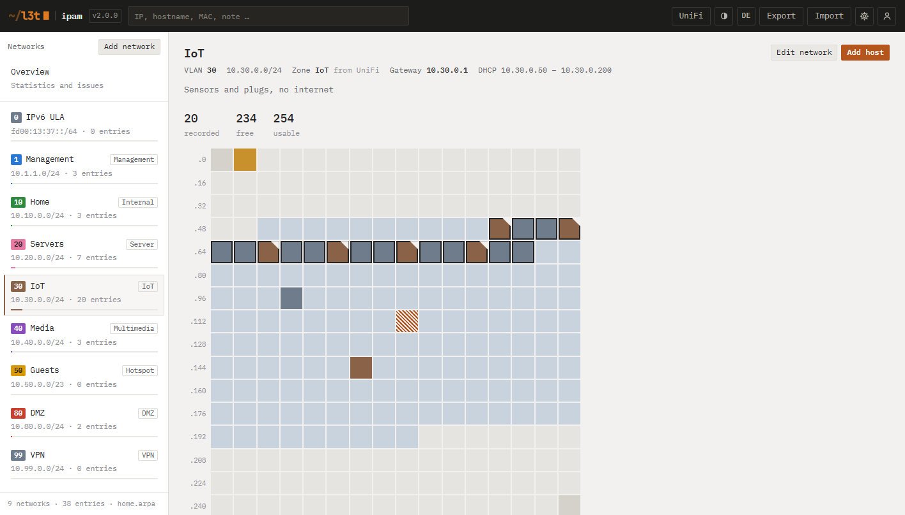
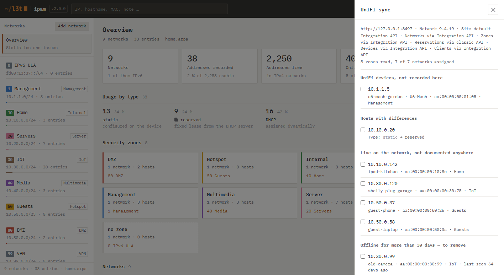
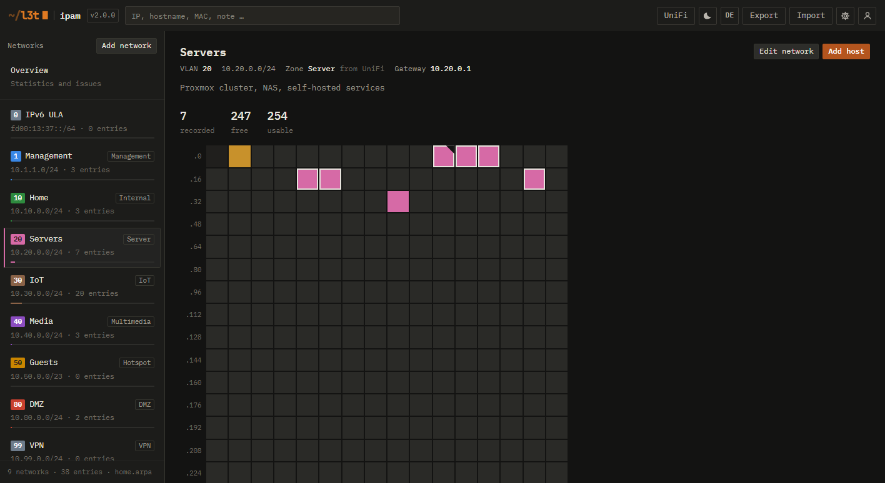
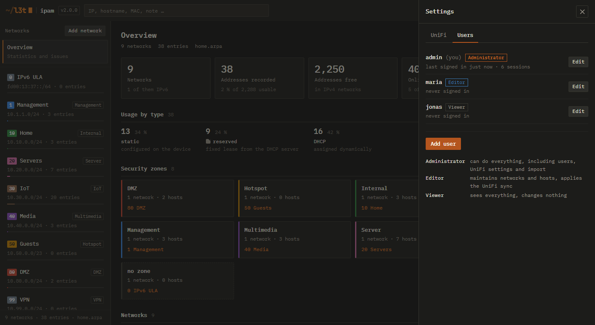
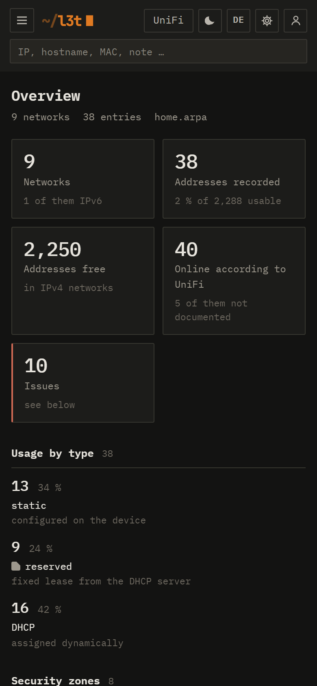

# L3T IPAM

**Schlankes IP-Adressmanagement fürs Homelab — mit UniFi-Abgleich.**

Netze und Hosts dokumentieren, jede Adresse auf einen Blick sehen und die Dokumentation
mit dem UniFi-Controller abgleichen. Ein kleiner Container, keine Datenbank, keine
Abhängigkeiten.

[English](README.md) · [Changelog](CHANGELOG.md) · [Anleitung Synology](SYNOLOGY.md)



## Funktionen

- **Netze und Hosts** — VLAN-ID, Subnetz, Gateway, DHCP-Bereich, Sicherheitszone,
  DNS-Namen, MAC, Rolle und Notizen. IPv4 mit Belegungsraster je Netz; IPv6-Netze werden
  gespeichert und aufgelistet.
- **Belegungsraster** — jede Adresse eines Netzes als Zelle: statisch, reserviert,
  DHCP-Lease, Gateway, DHCP-Bereich, frei. Mit UniFi bekommen Geräte, die online sind,
  einen Ring; Geräte, die antworten, aber nicht dokumentiert sind, erscheinen schraffiert
  — ein Klick dokumentiert sie.
- **Übersicht** — Belegung je Netz, nächste freie statische Adresse, Hosts je
  Sicherheitszone und eine Liste von Auffälligkeiten: statische Adressen im DHCP-Bereich,
  doppelte Adressen oder MACs, überlappende Netze, Hosts ausserhalb ihres Subnetzes,
  Netze ohne Gateway oder Zone, lange offline gewesene Geräte. Jede Auffälligkeit lässt
  sich bewusst ausblenden.
- **UniFi-Abgleich (nur lesend)** — liest Netze, feste Reservierungen, UniFi-Geräte,
  verbundene Clients und die Sicherheitszonen der Firewall über die offizielle
  Integration API, mit Rückfall auf die klassische Controller-API. Jede Änderung wird
  vor dem Übernehmen angezeigt; nur die Sicherheitszonen werden automatisch gespiegelt.
  UniFi selbst wird nie verändert. Kommt mit Praxisfällen zurecht: veraltete
  Reservierungen, Geräte, die andere durchreichen (etwa eine Sonos-Soundbar mit
  Rear-Lautsprechern), längst verschwundene Clients.
- **Offline-Aufräumen** — Hosts entfernen, die UniFi seit N Tagen nicht gesehen hat, von
  Hand oder automatisch, mit Sicherungen (vorgegeben nur DHCP-Einträge, nie unbekannte
  Geräte, Abbruch wenn zu viele betroffen wären, vorher eine Sicherung).
  Batteriegeräte lassen sich als «sporadisch» markieren.
- **Sicherheitszonen** mit festen Farben (DMZ, Hotspot, Internal, Management, Multimedia,
  Server, VPN) — geprüft auf Unterscheidbarkeit, hell wie dunkel.
- **Benutzer und Rollen** — Administrator, Bearbeiten, Lesen. Eigene Anmeldung mit
  scrypt-Hashes, Sperre nach Fehlversuchen, widerrufbare Sitzungen. Gedacht für den
  Betrieb hinter einem Cloudflare-Tunnel oder Reverse Proxy ohne zusätzliche Anmeldung.
- **Deutsch und Englisch**, helles und dunkles Erscheinungsbild, auch am Handy.
- **Ablage als JSON** mit Tagessicherungen — lesbar, leicht zu sichern, leicht umzuziehen.

## Screenshots

| | |
|---|---|
|  |  |
| Belegungsraster — statisch, reserviert (Ecke), DHCP-Leases, Online-Ring, undokumentiert (schraffiert) | UniFi-Abgleich — prüfen vor dem Übernehmen |
|  |  |
| Dunkles Erscheinungsbild, Netzfarben folgen der Sicherheitszone | Benutzer und Rollen |



(Screenshots in der englischen Oberfläche — umschaltbar oben rechts mit «DE».)

## Schnellstart (Docker)

```yaml
# docker-compose.yml
services:
  l3t-ipam:
    image: ghcr.io/l3t-io/ipam:2
    container_name: l3t-ipam
    restart: unless-stopped
    ports:
      - "8080:8080"
    volumes:
      - ./data:/data
    environment:
      PUID: "1000"          # Eigentümer von ./data auf dem Host
      PGID: "1000"
      IPAM_DOMAIN: home.arpa
      IPAM_LANG: de         # Sprache des Container-Protokolls
```

```sh
docker compose up -d
docker compose logs l3t-ipam    # zeigt den einmaligen Einrichtungscode
```

`http://<host>:8080` öffnen, den Einrichtungscode aus dem Protokoll eingeben und das
erste Konto anlegen — es wird Administrator. Images gibt es für `linux/amd64` und
`linux/arm64` (Raspberry Pi 4/5).

**Synology:** Schritt für Schritt in [SYNOLOGY.md](SYNOLOGY.md).

## UniFi anbinden

1. In UniFi Network: *Einstellungen → Control Plane → Integrationen → Create New API Key*.
   Der Schlüssel erbt die Rechte des Kontos, das ihn erzeugt (braucht Administratorrechte).
2. In L3T IPAM: Zahnrad → *UniFi* → Controller-Adresse (etwa `https://10.1.1.1`),
   API-Schlüssel, Site (meist `default`) → *Verbindung testen* → *Speichern*.
3. Der Knopf *UniFi* oben öffnet den Abgleich.

Der Schlüssel liegt in `data/unifi.json` und geht nie zurück an den Browser. Wer die
Controller-Adresse ändert, muss den Schlüssel neu eingeben — so lässt er sich nicht an
eine fremde Adresse umleiten.

UniFi-Controller haben ab Werk ein selbst signiertes Zertifikat, deshalb ist die Prüfung
über eine Zertifizierungsstelle vorgegeben aus. Stattdessen merkt sich L3T IPAM beim
Speichern das Zertifikat des Controllers und vergleicht jede spätere Verbindung damit,
bevor der API-Schlüssel gesendet wird. Ändert sich das Zertifikat (etwa nach einem Update
des Controllers), stoppt der Abgleich mit einer klaren Meldung — erneut speichern
bestätigt das neue Zertifikat.

## Konfiguration

Konten und UniFi-Anbindung werden in der Oberfläche gepflegt und liegen in `data/`.
Umgebungsvariablen regeln nur den Betrieb:

| Variable | Vorgabe | Bedeutung |
|---|---|---|
| `IPAM_DATA` | `/data` (Image) | Datenordner |
| `IPAM_PORT` / `IPAM_HOST` | `8080` / `0.0.0.0` | Adresse, auf der der Server lauscht |
| `IPAM_DOMAIN` | `home.arpa` | Domain für automatisch ergänzte DNS-Namen |
| `IPAM_LANG` | `en` | Sprache des Container-Protokolls (`en`, `de`) |
| `PUID` / `PGID` | `1000` | Eigentümer des Datenordners; die App gibt Root-Rechte an ihn ab |
| `IPAM_TRUST_PROXY` | aus | `1` hinter Reverse Proxy / Cloudflare-Tunnel: Sperre pro echter Adresse, `Secure`-Cookie über HTTPS |
| `IPAM_COOKIE_SECURE` | aus | `1` setzt `Secure` am Cookie immer |
| `IPAM_USER` / `IPAM_PASS` | — | zusätzlicher Administrator aus der Umgebung, etwa als Notfallzugang |
| `IPAM_AUTH` | an | `off` schaltet die Anmeldung ab (nur hinter einer anderen Anmeldung) |
| `IPAM_UNIFI_URL` / `_KEY` / `_SITE` | — | Rückfall für die UniFi-Anbindung, solange in der Oberfläche nichts gespeichert ist |
| `IPAM_UNIFI_USER` / `_PASS` | — | Konto für Controller ohne Integration API (Network vor 9.3) |

## Daten und Sicherung

Alles liegt als lesbares JSON im Datenordner:

- `ipam.json` — Netze, Hosts, Einstellungen
- `ipam-JJJJ-MM-TT.bak.json` — Tagessicherung, die letzten 14 bleiben
- `auth.json` — Benutzer, Rollen, Passwort-Hashes · `sessions.json` — Sitzungs-Hashes
- `unifi.json` — Controller-Adresse und API-Schlüssel

Wer den Ordner sichert, hat alles. *Sichern* oben lädt den Bestand als JSON herunter,
*Laden* importiert einen (nur Administratoren).

## Sicherheit

- Eigene Anmeldung mit scrypt, Sitzungs-Cookies mit `HttpOnly`/`SameSite=Strict`, Sperre
  nach 10 Fehlversuchen je Absender, Sicherheits-Header (CSP, kein Einbetten),
  CSRF-Schutz für alle schreibenden Anfragen, Rollenprüfung auf dem Server bei jeder
  Anfrage.
- Einziges Administratorpasswort vergessen? Vorübergehend `IPAM_USER`/`IPAM_PASS` setzen,
  anmelden, unter Zahnrad → Benutzer das Passwort neu setzen, Variablen wieder entfernen.
- Aus dem Internet erreichbar? Nur über HTTPS (Reverse Proxy oder Cloudflare-Tunnel) und
  mit `IPAM_TRUST_PROXY=1`.

Sicherheitslücke gefunden? Bitte vertraulich melden — siehe [SECURITY.md](SECURITY.md).

## Entwicklung

Node.js 20 oder neuer, kein `npm install` nötig.

```sh
npm start          # http://localhost:8080, Daten in ./data
npm test           # alle Tests (node:test)
npm run package    # Synology-ZIP (Variante mit eingehängtem Code) nach _exports/
```

Ohne Anmeldung entwickeln: `IPAM_AUTH=off npm start`.

Release: `APP_VERSION` in `app/server.js` und `package.json` anheben, Eintrag im
Changelog, Tag `vX.Y.Z` — der Tag baut und veröffentlicht das Container-Image.

## Lizenz

MIT — siehe [LICENSE](LICENSE).

UniFi ist eine Marke von Ubiquiti Inc. L3T IPAM ist ein unabhängiges Projekt und steht
in keiner Verbindung zu Ubiquiti.
