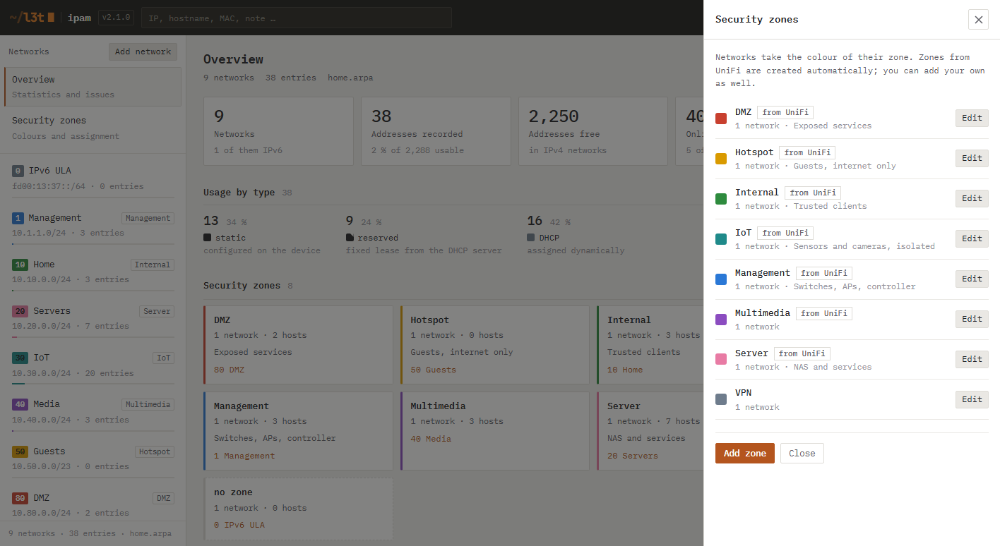

<a href="https://l3t.io"><picture>
  <source media="(prefers-color-scheme: dark)" srcset="docs/brand/l3t-negativ.svg">
  
</picture></a>

# L3T IPAM

**Lightweight IP address management for home labs — works with UniFi.**

Document your networks and hosts, see every address at a glance, and keep the
documentation in sync with your UniFi controller. One small container, no database,
no dependencies.

[Deutsch](README.de.md) · [Changelog](CHANGELOG.md) · [Synology guide](SYNOLOGY.md)

[](https://ko-fi.com/M2P628W1P2)


## Features

- **Networks and hosts** — VLAN ID, subnet, gateway, DHCP range, security zone, DNS
  names, MAC, role and notes. IPv4 with an address grid per network; IPv6 networks are
  stored and listed.
- **Address grid** — every address of a network as a cell: static, reserved, DHCP lease,
  gateway, DHCP range, free. With UniFi connected, online devices get a ring and devices
  that answer but aren't documented are hatched — one click documents them.
- **Overview** — usage per network, next free static address, hosts per security zone,
  and an issues list: static addresses inside the DHCP range, duplicate addresses or MACs,
  overlapping networks, hosts outside their subnet, networks without gateway or zone,
  devices offline for a long time. Each issue can be hidden on purpose.
- **UniFi sync (read-only)** — reads networks, fixed-IP reservations, UniFi devices,
  connected clients and firewall security zones via the official Integration API, with
  fallback to the classic controller API. You review every change before it is applied;
  only security zones are mirrored automatically (and created here if missing). UniFi
  itself is never modified.
  Handles real-world cases: stale reservations, devices bridging others (e.g. a Sonos
  soundbar with surrounds), clients that left long ago.
- **Offline cleanup** — remove hosts UniFi hasn't seen for N days, manually or on a
  schedule, with safeguards (DHCP entries only by default, never unknown devices, aborts
  if too many would go, backup first). Battery devices can be marked «sporadic».
- **Security zones** — create, rename, recolour and delete zones; networks take the
  colour of their zone. Zones from UniFi are created automatically (name owned by UniFi,
  colour and description editable here). Seven palette colours validated to stay
  distinguishable in light and dark mode, plus custom colours. Well-known zones (DMZ,
  Hotspot, Internal, Management, Multimedia, Server, VPN) start with an established
  colour; networks without a zone keep their own colour.
- **Users and roles** — Administrator, Editor, Viewer. Built-in login with scrypt
  password hashes, lockout after failed attempts, sessions you can revoke. Designed to
  sit behind a Cloudflare Tunnel or reverse proxy without an extra auth layer.
- **English and German**, light and dark theme, works on the phone.
- **Plain JSON storage** with daily backups — readable, easy to back up, easy to move.

## Screenshots

| | |
|---|---|
|  |  |
| Address grid — static, reserved (corner), DHCP leases, online ring, undocumented (hatched) | UniFi sync — review before applying |
|  |  |
| Dark mode, network colours follow the security zone | Users and roles |
|  | |
| Security zones — colour, description, source | |


## Quick start (Docker)

```yaml
# docker-compose.yml
services:
  l3t-ipam:
    image: ghcr.io/l3t-io/ipam:2
    container_name: l3t-ipam
    restart: unless-stopped
    ports:
      - "8080:8080"
    volumes:
      - ./data:/data
    environment:
      PUID: "1000"          # owner of ./data on the host
      PGID: "1000"
      IPAM_DOMAIN: home.arpa
```

```sh
docker compose up -d
docker compose logs l3t-ipam    # shows the one-time setup code
```

Open `http://<host>:8080`, enter the setup code from the log and create the first
account — it becomes Administrator. Images are built for `linux/amd64` and `linux/arm64`
(Raspberry Pi 4/5).

**Synology:** see the step-by-step guide in [SYNOLOGY.md](SYNOLOGY.md).

## Connecting UniFi

1. In UniFi Network: *Settings → Control Plane → Integrations → Create New API Key*.
   The key inherits the permissions of the account that creates it (needs admin).
2. In L3T IPAM: gear icon → *UniFi* → controller address (e.g. `https://10.1.1.1`),
   API key, site (usually `default`) → *Test connection* → *Save*.
3. The *UniFi* button in the top bar opens the sync.

The key is stored in `data/unifi.json` and never sent back to the browser. Changing the
controller address requires entering the key again, so it can't be redirected elsewhere.

UniFi controllers ship with a self-signed certificate, so certificate *authority* checks are
off by default. Instead, L3T IPAM pins the controller's certificate when you save the
connection: every later connection is compared against that fingerprint before the API key
is sent. If the certificate changes (e.g. after a controller update), the sync stops with a
clear message — save the connection again to accept the new certificate.

## Configuration

Accounts and the UniFi connection are managed in the web UI and live in `data/`.
Environment variables cover operations only:

| Variable | Default | Purpose |
|---|---|---|
| `IPAM_DATA` | `/data` (image) | Data folder |
| `IPAM_PORT` / `IPAM_HOST` | `8080` / `0.0.0.0` | Listen address |
| `IPAM_DOMAIN` | `home.arpa` | Domain appended to host names |
| `IPAM_LANG` | `en` | Language of the container log (`en`, `de`) |
| `PUID` / `PGID` | `1000` | Owner of the data folder; the app drops root privileges to it |
| `IPAM_TRUST_PROXY` | off | `1` behind a reverse proxy / Cloudflare Tunnel: per-client lockout and `Secure` cookie on HTTPS |
| `IPAM_COOKIE_SECURE` | off | `1` always sets `Secure` on the session cookie |
| `IPAM_USER` / `IPAM_PASS` | — | Additional administrator from the environment, e.g. as emergency access |
| `IPAM_AUTH` | on | `off` disables the login (only behind another authentication layer) |
| `IPAM_UNIFI_URL` / `_KEY` / `_SITE` | — | Fallback UniFi connection while none is saved in the UI |
| `IPAM_UNIFI_USER` / `_PASS` | — | Account login for controllers without Integration API (Network < 9.3) |

## Data and backups

Everything lives in the data folder as readable JSON:

- `ipam.json` — networks, hosts, settings
- `ipam-YYYY-MM-DD.bak.json` — daily backup, the last 14 are kept
- `auth.json` — users, roles, password hashes · `sessions.json` — session hashes
- `unifi.json` — controller address and API key

Back up the folder and you have everything. *Export* in the top bar downloads the
inventory as JSON; *Import* loads one (administrators only).

## Security notes

- Built-in login with scrypt, `HttpOnly`/`SameSite=Strict` session cookies, lockout after
  10 failed attempts per client, security headers (CSP, no framing), CSRF protection on
  all write requests, server-side role checks on every request.
- Forgot the only administrator password? Set `IPAM_USER`/`IPAM_PASS` temporarily, log in,
  reset the password under gear → Users, remove the variables again.
- Exposing it to the internet? Put it behind HTTPS (reverse proxy or Cloudflare Tunnel)
  and set `IPAM_TRUST_PROXY=1`.

Found a vulnerability? Please report it privately — see [SECURITY.md](SECURITY.md).

## Development

Node.js 20 or newer, no `npm install` needed.

```sh
npm start          # http://localhost:8080, data in ./data
npm test           # all tests (node:test)
npm run package    # Synology ZIP (mounted-code variant) into _exports/
```

Without login while developing: `IPAM_AUTH=off npm start`.

Releases: bump `APP_VERSION` in `app/server.js` and `package.json`, add a changelog
entry, tag `vX.Y.Z` and push the tag. Everything else is automatic: the workflow checks
that tag, version and changelog match, builds and publishes the container image, then
creates the GitHub release with the changelog section as notes and the Synology ZIP
attached. Preview the notes locally with `node scripts/release-notes.js`.

## Support

L3T IPAM is free and stays free — no paid tier, no tracking. If it saves you time, you can
buy me a coffee:

[](https://ko-fi.com/M2P628W1P2)

Bug reports and ideas are just as welcome: [issues](https://github.com/l3t-io/ipam/issues).

## License

MIT — see [LICENSE](LICENSE). The bundled IBM Plex Mono font is under the SIL Open Font
License, see [app/public/fonts/LICENSE.txt](app/public/fonts/LICENSE.txt).

UniFi is a trademark of Ubiquiti Inc. L3T IPAM is an independent project and is not
affiliated with or endorsed by Ubiquiti.
